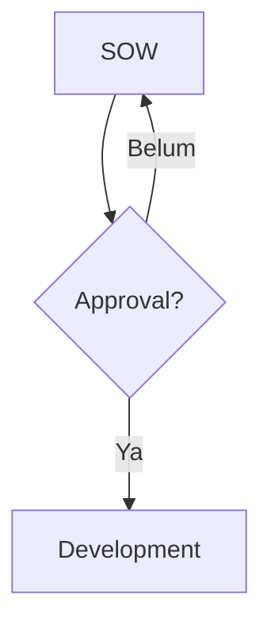

# Panduan Pengguna

## Masuk

Buka aplikasi dan pilih **Masuk dengan Google**. Hanya akun yang sudah diizinkan
yang bisa masuk. Kalau muncul "akun Google ini belum terdaftar", minta
administrator menambahkan alamat email Anda.

## Mencari dan membaca

1. Buka **Cari** di menu, lalu ketik kata dari gejala atau judul.
2. Buka hasil yang cocok. Di bawah dokumen ada **Pengetahuan Terkait**: dokumen lain yang sebaiknya dibaca bersamanya.
3. **Koleksi** mengelompokkan dokumen per topik.

Tips pencarian:

- Hasil diurutkan dari yang paling cocok; judul lebih berbobot daripada isi.
- Kata berimbuhan dikenali: mencari "memotong" juga menemukan "dipotong" dan "pemotongan".
- Beberapa kata berarti semuanya harus ada di dokumen. Awalan kata juga cocok ("kupo" menemukan "kupon").
- Pakai tanda kutip untuk frasa yang kata-katanya harus berurutan, misalnya "gagal closing".
- Pilih **Panduan**, **Masalah**, atau **Referensi**, dan satu koleksi, untuk mempersempit hasil.
- Kata yang cocok ditebalkan. Kalau cocoknya hanya di isi dokumen, potongan kalimatnya ditampilkan.
- Yang tampil paling banyak 50 hasil teratas. Tambahkan kata atau filter bila belum ketemu.
- Pencarian mencocokkan kata utuh atau awalan kata, bukan potongan di tengah kata.
- Draf dan arsip hanya muncul di hasil pencarian Editor dan Admin.

## Siapa yang terakhir mengubah, dan riwayat (EDITOR dan ADMIN)

Di bawah judul dokumen tertulis kapan dan oleh siapa dokumen terakhir diubah. Editor dan admin juga
melihat tautan **Riwayat**: daftar setiap versi dengan penyuntingnya, waktunya, dan selisih karakter.
Pilih sebuah versi untuk membaca isinya saat itu, membandingkannya, atau memulihkannya (lihat bagian
berikutnya). Hal yang perlu diketahui:

- Simpan yang mengubah judul, ringkasan, jenis, atau isi menjadi versi baru. Mengganti status (terbitkan, arsipkan, kembalikan ke draf) juga menjadi versi, dengan label seperti "Diterbitkan" atau "Diarsipkan" di daftar, jadi Anda bisa melihat siapa yang mengarsipkan dokumen dan kapan. Menyimpan tanpa mengubah apa pun, atau menetapkan status yang sudah berlaku, tidak membuat versi.
- Maksimal 100 versi terakhir per dokumen yang disimpan.
- Dokumen yang dibuat sebelum fitur ini baru punya riwayat sejak simpan pertama sesudahnya (isi sebelumnya jadi versi 1; penulisnya adalah penulis awal dokumen bila tercatat, kalau tidak tertulis "tidak diketahui").
- Pembaca biasa tidak melihat riwayat.

## Daftar isi dan tautan ke bagian

Dokumen yang panjang punya daftar isi: di layar lebar ada di kolom kanan, di HP ada lipatan
**Di halaman ini** di atas teks. Arahkan kursor ke judul bagian (di HP, ikon tautan tampak samar di
sebelahnya) dan ketuk ikon tautan untuk menyalin alamat langsung ke bagian itu, misalnya untuk dikirim
ke rekan: "buka bagian Verifikasi".

## Jenis dokumen

- **Panduan**: langkah mengerjakan sesuatu.
- **Masalah**: gejala yang dilaporkan, cara memeriksa, dan cara memastikan sudah beres.
- **Referensi**: data yang dicari ulang, seperti tabel atau daftar.

## Menulis (EDITOR dan ADMIN)

1. Buka koleksi, pilih **Dokumen Baru**, lalu pilih jenisnya. Kerangka bagian akan terisi.
2. Tulis isinya. Yang Anda lihat adalah hasil akhirnya. Mengetik `## ` di awal baris menjadi judul, `- ` menjadi daftar, `**tebal**` menjadi tebal. Ketik `/` di baris kosong untuk menyisipkan judul, daftar, daftar centang, kutipan, blok kode, tabel, atau garis pemisah. Di HP, bilah alat tampil tepat di atas keyboard. Tombol **Mode Markdown** dipakai untuk menempel dari Obsidian. Baris kosong tambahan dari Enter berulang tidak ikut tersimpan; jarak antarparagraf diatur otomatis. Dokumen yang berisi gambar, catatan kaki, atau HTML mentah dibuka dalam Mode Markdown dengan pemberitahuan; itu disengaja, karena editor visual akan menghilangkan bagian tersebut bila disimpan.
3. Di bagian **Pengetahuan Terkait**, ketik judul dokumen lain lalu pilih untuk menautkannya (maksimal 20). Hubungannya dua arah: dokumen yang Anda pilih juga akan menampilkan dokumen ini, dan menghapusnya dari salah satu sisi menghapus keduanya. Pembaca biasa hanya melihat yang sudah terbit.
4. Simpan sebagai **Draf** dulu. Ubah ke **Terbit** saat siap dibaca orang lain.

Tulisan Anda disimpan otomatis di perangkat sebagai draf lokal. Kalau halaman
tertutup sebelum tersimpan, akan ada tawaran **Pulihkan** saat dibuka lagi.

## Membatasi koleksi (ADMIN)

Sebagian pengetahuan, misalnya gaji atau keuangan, tidak perlu terbaca semua orang. Admin bisa membatasi satu koleksi:

1. Buka koleksinya, pilih **Edit** (atau buat **Koleksi Baru**).
2. Centang **Batasi akses**, lalu cari nama atau email orang yang boleh masuk dan pilih. Hanya orang yang pernah masuk ke aplikasi yang muncul di daftar.
3. Simpan. Mulai saat itu, hanya admin dan orang yang dipilih yang bisa melihat koleksi itu, semua dokumen di dalamnya, hasil pencarian, favorit, dan daftar terkait. Bagi yang lain koleksinya seolah tidak ada (bukan "akses ditolak").

Hal yang perlu diketahui:

- Admin selalu bisa membaca. Editor yang dipilih bisa membaca **dan menulis** di koleksi itu; editor yang tidak dipilih tidak bisa menulis atau memindahkan dokumen ke sana. Viewer yang dipilih hanya membaca.
- Mencabut akses langsung berlaku di server. Salinan yang sudah tersimpan di perangkat seseorang (untuk dibaca tanpa internet) dikosongkan **saat ia membuka aplikasi dengan internet berikutnya**; sampai saat itu salinan lama di perangkatnya masih bisa terbaca.
- Mematikan **Batasi akses** membuka koleksi untuk semua orang, tetapi daftar anggotanya disimpan, jadi menyalakannya lagi tidak perlu memilih ulang.
- Editor anggota bisa memindahkan dokumen dari koleksi terbatas ke koleksi terbuka; riwayatnya ikut terbaca semua orang. Pindahkan hanya bila memang dimaksudkan.
- Slug dokumen dipakai bersama semua koleksi: editor di luar koleksi bisa tahu bahwa suatu slug sudah dipakai, tetapi tidak judul atau isinya.

## Membatasi satu dokumen (ADMIN)

Kalau hanya satu dokumen yang sensitif, tidak perlu membatasi seluruh koleksinya:

1. Buka dokumennya, pilih **Edit** (atau buat **Dokumen Baru**).
2. Di bagian **Batasi akses dokumen ini**, centang kotaknya, lalu cari nama atau email orang yang boleh membaca dan pilih.
3. Simpan. Mulai saat itu hanya admin dan orang yang dipilih yang melihat dokumen itu, termasuk lewat pencarian, riwayat, favorit, dan daftar terkait. Bagi yang lain dokumennya seolah tidak ada. Dokumen terbatas bergembok di daftar.

Hal yang perlu diketahui:

- **Koleksinya tetap berlaku.** Kalau koleksinya juga terbatas, orang itu harus ada di daftar koleksi **dan** di daftar dokumen. Berada di daftar dokumen tidak membuka koleksi yang tertutup.
- Hanya admin yang bisa membatasi dokumen atau mengubah daftarnya; editor tidak melihat bagian ini. Editor yang ada di daftar tetap bisa membaca dan menyunting dokumennya.
- Mengubah batas atau daftar **bukan suntingan isi**: tidak membuat versi baru dan tidak mengubah "Diperbarui".
- Mencabut akses langsung berlaku di server. Salinan yang sudah tersimpan di perangkat seseorang dikosongkan saat ia membuka aplikasi dengan internet berikutnya.
- Mematikan kotaknya membuka dokumen untuk semua orang (sesuai koleksinya), tetapi daftar disimpan.
- Riwayat versi tetap memuat isi lama; siapa pun yang bisa membaca dokumen itu sekarang bisa membaca riwayatnya.

## Mengundang pengguna dan mengatur peran (ADMIN)

Buka **Pengguna** di menu samping (bagian Admin), atau alamat `/admin/users`.

- **Undang**: isi email Google orangnya dan pilih peran (Viewer membaca, Editor menulis dan menerbitkan, Admin juga mengelola koleksi dan pengguna). Aplikasi tidak mengirim email: beri tahu orangnya, lalu ia masuk dengan akun Google yang sama dan langsung mendapat peran itu. Selama belum masuk, ia tampil di "Menunggu masuk" dan undangannya bisa dibatalkan.
- **Ubah peran**: pilih peran baru di daftar; berlaku langsung.
- **Cabut akses**: tombol Cabut menghapus undangan dan mengeluarkan orangnya dari semua perangkat. Akunnya dan tulisannya tetap. Kalau emailnya masih cocok dengan `AUTH_ALLOWED_DOMAIN` atau `AUTH_ALLOWED_EMAILS`, ia tetap bisa masuk lagi sebagai peran awalnya; hapus dari pengaturan itu juga bila perlu.
- Admin dari `AUTH_ADMIN_EMAILS` dan akun Anda sendiri tidak bisa diubah di sini.

## Menyisipkan dan melihat pratinjau langkah, peringatan, dan diagram

Di editor, ketik `/` lalu pilih **Langkah bergambar**, **Kotak peringatan**, atau **Diagram alur** (atau pakai tiga tombol di ujung toolbar). Contoh yang valid disisipkan; ubah teksnya, dan **pratinjau** di bawah blok langsung berubah mengikuti (diagram menyusul sesaat setelah Anda berhenti mengetik). Di mode Markdown, tombol **Pratinjau** menampilkan seluruh halaman seperti yang akan dilihat pembaca.

## Langkah bergambar dan kotak peringatan

Untuk SOP atau urutan kerja yang dibaca staf non-teknis, tampilannya seperti lembar SOP di Canva: kartu bernomor, bukan diagram. Tulis di dalam blok kode berbahasa `langkah`, satu langkah per baris, judul singkat lalu garis tegak `|` lalu satu kalimat penjelasan:

```langkah
SOW | Scope disepakati
Design Flow | Design wajib jika ada perubahan flow
Approval | Project Leader, lalu Project Controller
```

Nomornya dibuat otomatis (maksimal 12 langkah). Untuk satu hal yang tidak boleh keliru, pakai blok berbahasa `peringatan`: baris pertama judulnya, baris berikutnya tindakannya. Hasilnya kotak merah. Bagian "Wajib ada" dan "Cek diri" cukup daftar biasa; daftar centang `- [ ] ...` tampil sebagai kotak centang. Admin bisa meminta Asisten AI: "buatkan SOP ini dalam bentuk langkah bergambar". Pakai diagram (di bawah) hanya bila alurnya bercabang.

## Diagram alur di dokumen

Tulis diagram sebagai teks di dalam blok kode berbahasa `mermaid` (di editor teks/Markdown; di editor visual, buat blok kode lalu isi bahasanya). Contoh:



Di halaman dokumen, blok itu tampil sebagai diagram dan ikut tercetak ke PDF. Aturan singkat: id simpul huruf dan angka saja, label pendek dalam tanda kutip ganda. Pertanyaan memakai kotak membulat `C("Sudah disetujui?"):::decision` (hindari belah ketupat), awal dan akhir `A(["Mulai"]):::start` dan `Z(["Selesai"]):::done`, perbaikan `X["Lengkapi dulu"]:::stop`; warnanya sudah tersedia. Di halaman dokumen, tombol **Perbesar** membuka diagram dengan zoom. Tag HTML (selain `<br>`), `click`, `url(` dan `%%{...}%%` tidak diizinkan. Kalau penulisannya salah atau ditolak, yang tampil adalah pesan dan teks aslinya, jadi tidak ada yang hilang. Admin bisa cukup meminta Asisten AI: "buat flow diagram dari langkah ini". Tulis juga langkahnya sebagai daftar bernomor di bawah diagram, untuk pencarian dan saat diagram tidak bisa tampil.

## Cadangan: mengekspor semua dokumen (ADMIN)

Menu **Ekspor** (bagian Admin) mengunduh semua dokumen sebagai satu zip: satu folder per koleksi, satu berkas Markdown per dokumen. Ada juga tombol untuk satu koleksi. Zip memuat **semua** dokumen, termasuk draf, yang diarsipkan, dan yang terbatas, jadi simpan di tempat yang aman. Di dalamnya ada `README.txt` (penjelasan) dan `manifest.json` (daftar dokumen dan statusnya). Pengunduhan dibatasi tiga kali per sepuluh menit. Untuk memasukkan kembali: ekstrak zip ke folder di luar repositori (jangan ke `content/drafts/`, isinya tidak boleh masuk Git) lalu jalankan `npm run docs:import -- --dir <folder>`; yang alamatnya sudah ada dilewati dan yang baru masuk sebagai draf.

## Melihat, membandingkan, dan memulihkan versi lama (EDITOR dan ADMIN)

Di halaman dokumen, **Riwayat** menampilkan setiap versi yang tersimpan. Buka satu versi untuk memilih tampilan: **Isi versi ini**, **Beda dengan versi sebelumnya** (apa yang berubah pada simpan itu), atau **Beda dengan sekarang** (apa yang berubah sejak versi itu). Baris hijau ditambahkan, merah dihapus, dan bagian yang tidak berubah dilipat.

**Pulihkan versi ini** menaruh judul, ringkasan, jenis, dan isi versi itu kembali ke dokumen. Anda ditanya dulu. Hasilnya **versi baru** di riwayat, jadi tidak ada yang hilang: salah pulihkan? Pulihkan versi yang tadi. Alamat, koleksi, dan status terbit tidak berubah.

## Koleksi dengan banyak dokumen

Halaman koleksi menampilkan 50 dokumen per halaman, terbaru dulu; pakai **Sebelumnya** dan **Berikutnya** di bawah daftar. Alamat `?halaman=2` bisa dibagikan. Untuk mencari dokumen tertentu di koleksi besar, pakai **Cari** dan pilih koleksinya.

Di form dokumen, bagian **Pengetahuan Terkait** mencari di seluruh dokumen yang boleh Anda baca: ketik sedikitnya dua huruf dari judulnya.

## Membagikan dan menyimpan dokumen sebagai PDF

Di halaman dokumen ada tombol **Bagikan** dan **Simpan PDF** untuk semua orang yang bisa membaca dokumen itu.

- **Bagikan**: di HP terbuka menu bagikan bawaan (WhatsApp dan lainnya); di komputer tautan disalin. Yang dikirim hanya judul dan tautan, tidak ada isi atau ringkasan. Penerima harus masuk dengan akunnya dan punya akses ke dokumen itu (koleksi atau dokumen terbatas tetap berlaku); orang di luar tim tidak bisa membukanya.
- **Simpan PDF**: membuka dialog cetak browser. Pilih **Simpan sebagai PDF** (di HP: Bagikan atau Cetak, lalu simpan sebagai PDF). Hasilnya tanpa menu samping, selalu berlatar putih, dan memuat asal dokumen di atas judul. PDF adalah salinan pada saat dicetak; tidak ikut berubah bila dokumen diedit.

## Asisten AI untuk menulis dokumen (ADMIN)

Di **Dokumen Baru** dan **Edit Dokumen**, admin melihat tombol **Asisten AI**. Editor dan viewer tidak.

1. Buka panel, lalu tempel bahan (log tiket, catatan, teks dari sheet) dan tulis perintah, misalnya "buat panduan dari catatan ini".
2. AI membalas dan, bila bahannya cukup, mengusulkan dokumen. Kartu usulan menampilkan judul, koleksi, jenis, ringkasan, dan isi (buka "Lihat isi").
3. Bila ada kotak kuning, baca: usulan memuat sesuatu yang biasanya tidak boleh ada di dokumen (email, tautan, nomor panjang, kata sandi, nama orang). Perbaiki sebelum menyimpan.
4. Tekan **Terapkan ke form** untuk mengisi form (judul, slug, koleksi, jenis, ringkasan, isi). Bila form sudah berisi tulisan, Anda ditanya dulu. Slug dokumen yang sudah terbit tidak diubah.
5. Minta perubahan ("perpendek", "tambahkan Perlu dikonfirmasi") di panel yang sama; usulan baru menggantikan yang lama.
6. Periksa form, lalu simpan seperti biasa. AI tidak menyimpan atau menerbitkan apa pun.

Yang perlu diketahui: teks yang Anda kirim diproses oleh Anthropic API; percakapan disimpan di akun Anda selama 90 hari sejak pesan terakhir. Buka lagi lewat tombol **Riwayat** di panel (daftar percakapan Anda, buka untuk melanjutkan, ikon tempat sampah untuk menghapus), atau mulai yang baru dengan **Percakapan baru**. Riwayat hanya terlihat oleh Anda; admin lain tidak bisa membukanya. Jangan menempel kata sandi atau data pribadi pelanggan: yang ditempel ikut tersimpan sampai dihapus. Bahan yang terlalu panjang ditolak dengan pesan (tidak dipotong diam-diam), dan ada batas sekitar 20 permintaan per 10 menit per admin. Butuh internet. Selalu baca ulang hasilnya: AI bisa keliru atau melewatkan hal yang tidak ada di bahan.

## Sematan: Canva, video, dan slide di dalam dokumen (EDITOR dan ADMIN)

Di editor, ketik `/` lalu pilih **Sematan** (atau tombol bingkai di bilah alat), tempel tautan **Canva, YouTube, Google Slides, atau Figma** di baris pertama, dan tulis keterangan singkat di baris kedua (boleh kosong). Pratinjau muncul di bawahnya. Pembaca melihat kartu dengan tombol **Tampilkan**; kontennya baru dimuat dari penyedia saat tombol ditekan, dan **Buka di ...** selalu tersedia (juga saat offline atau dicetak). Agar tampil, tautannya harus bisa dibuka oleh pembaca di penyedianya: untuk Canva atur berbagi ("Siapa saja dengan tautan" bisa melihat), untuk Google Slides bagikan atau terbitkan ke web, untuk video pakai tautan YouTube biasa. Bila kartunya tampil tetapi bingkainya kosong, biasanya dokumen di penyedia itu masih pribadi (minta pembaca masuk atau ubah berbagi di sana); pembaca tetap bisa memakai **Buka di ...**. Tautan dari situs lain, dan daftar putar atau siaran langsung YouTube, tidak diterima dan tampil sebagai teks biasa.

## Templat: memulai dokumen dari yang sudah bagus (EDITOR dan ADMIN)

Di dokumen yang jadi contoh, tekan **Jadikan templat** (hanya dokumen yang terbuka untuk semua pengguna). Templat tersimpan lengkap dengan langkah bergambar, peringatan, dan bagian "Perlu dikonfirmasi". Saat membuat **Dokumen Baru**, pilih templat di **Mulai dari templat**: isi dan jenisnya terisi, lalu ubah sesuka Anda. **Kosong (bawaan)** memakai kerangka seperti biasa. Menu **Templat** menampilkan semuanya: **Pakai**, ganti nama, atau hapus (pembuatnya atau admin). Mengubah dokumen sumber tidak mengubah templatnya; buat ulang bila perlu.

## Masukan dari pembaca

**Pembaca:** di bagian bawah dokumen ada **Kirim masukan**. Tulis bagian yang kurang jelas, salah, atau sudah berubah (sampai 1000 karakter; jangan menulis kata sandi atau data pelanggan). Masukan hanya dibaca penyunting dokumen itu; orang lain tidak melihatnya. Di halaman yang sama Anda melihat masukan Anda, balasan penyunting, dan apakah sudah **Selesai**; membalas utas yang sudah selesai membukanya lagi. Satu orang paling banyak mengirim 10 masukan per jam.

**Penyunting dan admin:** **Masukan pembaca** di menu menampilkan semua masukan yang menunggu (tab **Selesai** untuk yang sudah ditangani), dengan nama penulisnya. Balas, lalu **Tandai selesai** setelah dokumennya diperbaiki; **Buka lagi** bila perlu. Di halaman dokumen, tombol **Masukan pembaca** menampilkan masukan khusus dokumen itu. Hapus bila isinya tidak pantas.

## Mode langkah: mengikuti langkah satu per satu

Di dokumen yang punya langkah bergambar, tekan **Mode langkah** (di atas halaman). Layar menampilkan satu langkah dengan huruf besar; kerjakan, lalu tekan **Selesai, lanjut**. **Sebelumnya** kembali satu langkah, **Daftar langkah** menampilkan semuanya (ketuk untuk loncat, kotak di kanan untuk menandai atau membatalkan). Peringatan merah muncul sebagai layar sendiri di tempatnya. Tanda selesai tersimpan di HP atau komputer ini saja, jadi kalau halaman ditutup dan dibuka lagi Anda melanjutkan dari langkah yang belum selesai; **Mulai ulang** di akhir menghapus tandanya. Kalau isi langkah diubah penulis, tandanya mulai dari awal. Layar dijaga tetap menyala selama dipakai (bila HP mendukung). Tombol ini hanya muncul di dokumen yang memang berisi blok langkah.

## Grup: mengatur akses untuk banyak orang sekaligus (ADMIN)

Buka **Grup** di menu, buat grup (misalnya Tim CS), lalu pilih anggotanya dan simpan. Di form koleksi atau dokumen yang **dibatasi**, centang grup yang boleh membaca; semua anggotanya ikut bisa membaca, selain orang yang dipilih satu per satu. Kalau seseorang ditambahkan ke grup atau dikeluarkan, aksesnya berubah saat itu juga, tanpa mengubah koleksi atau dokumennya. Untuk dokumen terbatas di dalam koleksi terbatas, orangnya harus lolos di kedua daftar (lewat nama atau grup). Menghapus grup mencabut akses yang hanya lewat grup itu.

## Dokumen bersarang: bab di bawah satu panduan (EDITOR dan ADMIN)

Untuk panduan yang punya banyak bagian (misalnya SOP 01 sampai 06 di bawah satu induk), buka halaman induknya lalu tekan **Tambah sub-halaman**; atau di form dokumen mana pun pilih **Induk**. Induk harus di koleksi yang sama, dan susunan paling dalam 4 tingkat. Di halaman induk muncul daftar **Halaman di bawah ini**; panah naik dan turun mengatur urutannya. Pembaca melihat breadcrumb di atas judul dan daftar bab di bawah isi. Daftar koleksi hanya menampilkan halaman tingkat atas; bab dibuka dari induknya (atau lewat pencarian). Memindahkan dokumen ke koleksi lain melepasnya dari induk; menghapus induk menjadikan bab-babnya halaman tingkat atas.

## Menghapus dan memulihkan dokumen (ADMIN)

**Hapus** di halaman dokumen memindahkan dokumen ke **Tempat sampah** (menu di bawah Ekspor); belum hilang. Di sana tiap dokumen punya **Pulihkan** (kembali apa adanya, lengkap dengan riwayat versi dan anggota) dan **Hapus permanen**. Setelah 30 hari dokumen di sampah hilang sendiri. Kalau alamat dokumen sudah dipakai dokumen baru, yang dipulihkan memakai alamat berakhiran `-pulih`. Kalau koleksinya sudah dihapus, buat koleksinya lagi dulu. Dua dokumen yang saling terkait lalu sama-sama dihapus kehilangan tautannya bila dipulihkan satu per satu (tautkan lagi lewat "Pengetahuan Terkait"); riwayat chat AI tidak lagi menunjuk ke dokumennya. Tempat sampah menampilkan 200 yang terbaru.

## Pencarian: sinonim dan salah ketik

Mencari "kasir" juga menemukan dokumen yang menulis "cashier", "retur" juga "return", dan seterusnya. Kalau tidak ada hasil sama sekali, pencarian menawarkan **Mungkin maksud Anda** berisi judul yang mirip dengan yang diketik, jadi salah ketik satu huruf tidak membuntu. Kata baru untuk daftar sinonim ditambahkan oleh pengembang (`src/lib/search-synonyms.ts`).

## Topik yang belum ada (EDITOR dan ADMIN)

Kalau pembaca mencari sesuatu dan tidak menemukan apa pun, kata yang dicari dicatat (tanpa nama pencari). Buka **Topik yang belum ada** di menu untuk melihat apa yang paling sering dicari tetapi belum ditulis. Tekan **Tulis** untuk membuat dokumen dengan judul terisi, atau **Abaikan** untuk menyembunyikan kata yang tidak relevan. Tulisan "sudah ada" berarti dokumennya ada tetapi masih draf, jadi tinggal diterbitkan. Catatan dibuang otomatis setelah 180 hari.

## Memasukkan draf dari berkas (ADMIN, perintah di komputer)

Dokumen yang disiapkan sebagai berkas di folder `content/drafts/` dimasukkan sebagai **draf** dengan `npm run docs:import` (lihat `content/drafts/README.md`). Hanya editor dan admin yang melihat draf; tinjau isinya, lengkapi bagian "Perlu dikonfirmasi", lalu tekan **Publish**. Menjalankannya ulang tidak menimpa dokumen yang sudah ada.

## Memakai tanpa internet

Pasang aplikasi ke layar utama (menu browser, lalu **Tambahkan ke layar utama**).
Halaman yang pernah Anda buka tetap bisa dibaca saat offline (kecuali pencarian, Favorit, dan Terakhir Dibuka). Bila akun atau peran di browser itu berganti, daftar halaman yang tersimpan dikosongkan dan terisi lagi seiring Anda membuka halaman. Menyimpan perubahan
butuh internet; tombol simpan nonaktif saat offline.

## Kalau muncul "Akses Ditolak"

Akun Anda berperan Viewer: hanya bisa membaca. Minta administrator menaikkan
peran Anda menjadi Editor untuk menulis dan mengubah dokumen.

## Favorit dan terakhir dibuka

- Di halaman dokumen, pilih **Tambah favorit** untuk menyimpannya. Semua favorit Anda ada di menu **Favorit**.
- Dokumen yang Anda baca otomatis tercatat di **Terakhir Dibuka** (maksimal 50, yang terbaru di atas).
- Keduanya khusus untuk akun Anda. Halaman Favorit dan Terakhir Dibuka butuh internet dan tidak tersimpan untuk dibaca offline, supaya daftar Anda tidak terlihat oleh orang lain yang memakai browser yang sama. Saat offline tombol favorit juga nonaktif.

## Yang belum tersedia

Lihat [FEATURES.md](./FEATURES.md) untuk fitur yang masih direncanakan.
